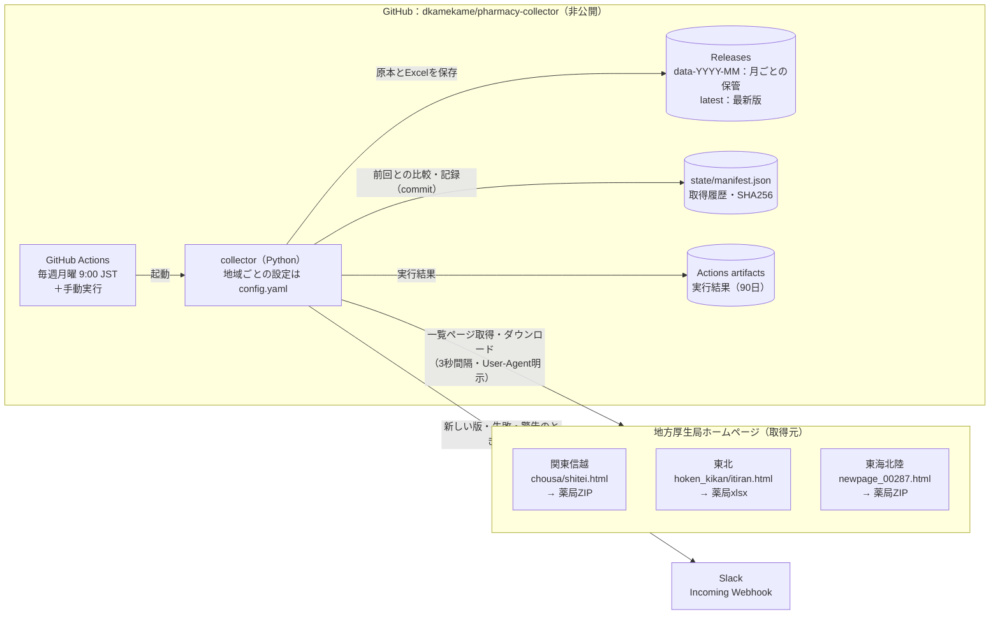
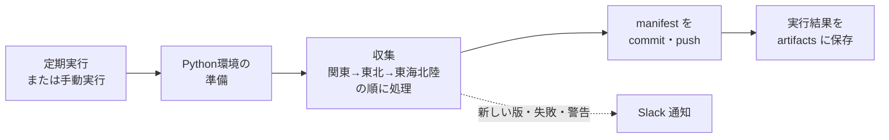
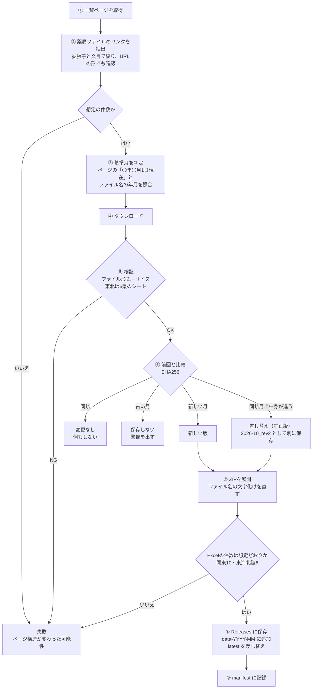

# pharmacy-collector

関東信越・東北・東海北陸の3厚生局のホームページから、「コード内容別医療機関一覧表（薬局）」の最新Excelを定期的に自動で集めるツール。
設計の背景と検討過程は [DESIGN.md](DESIGN.md) を参照。

| 地域 | 取得するもの（2026-10版の例） | 中身 |
|---|---|---|
| 関東信越 | `shitei_yakkyoku_r0810.zip` | 10都県分のxlsx |
| 東北 | `shitei-touhoku-yakkyoku-r0810.xlsx` | 1ファイルに6県分のシート |
| 東海北陸 | `2610-01-04.zip` | 6県分のxlsx |

## アーキテクチャ

サーバーは使わず、GitHub の中だけで完結する。GitHub Actions が週1回 Python の収集処理を動かし、取得したファイルを GitHub Releases に置く。



| 構成要素 | 役割 |
|---|---|
| GitHub Actions（[collect.yml](.github/workflows/collect.yml)） | 実行の基盤。毎週月曜 9:00 JST の定期実行と手動実行。サーバー不要 |
| collector（[src/collector/](src/collector/)） | 収集処理の本体。3地域で共通のコードで、違いは設定で吸収する |
| [config.yaml](config.yaml) | 地域ごとの一覧ページURL、リンクの抽出条件、想定の件数・シート名。サイト構造が変わったらここを直す |
| GitHub Releases | **ファイルの格納先**。`data-YYYY-MM` は月ごとに残し、`latest` は常に最新版に差し替える |
| [state/manifest.json](state/manifest.json) | 取得の記録。前回との比較（SHA256）に使い、実行のたびに commit する |
| Actions artifacts | 実行ごとの結果（`data/` と `report.json`）。確認用で90日後に消える |
| Slack | 新しい版、失敗、警告のときだけ通知する |

**この形にした理由**
- **週1回の確認にした**: 各ページは「〇年〇月1日現在」のデータを月初より後に掲載する（東海北陸の更新日は10/6だった）。毎月1日に実行すると前月の版を拾ってしまうので、週1回確認し、新しい版が出た週だけ保存する。
- **地域ごとの違いは設定に寄せた**: 配布の形が地域ごとに違う（関東はZIP、東北は1つのxlsxに6県分、東海北陸はZIP）。それでもコードは共通にし、違いは config.yaml だけに書く。
- **1地域の失敗で止めない**: 1つの地域が失敗しても、他の地域は続けて処理する。
- **原本を残し、加工は別にする**: このツールは原本の収集だけを担当し、Excelの中身には手を入れない。

## 処理フロー

### 1回の実行（ワークフロー全体）



### 地域ごとの処理



東北は配布がxlsxなので、⑦のZIP展開は行わない。全地域の処理が終わったら、基準日から45日以上新しい版が出ていない地域がないかを確かめてから、Slack に通知する。

| 処理 | 内容 | モジュール |
|---|---|---|
| ① 取得 | User-Agent を明示し、3秒以上の間隔をあける。5xxとタイムアウトは最大3回まで再試行し、SSLエラーは再試行しない | [http.py](src/collector/http.py) |
| ② 抽出 | 拡張子と文言の両方に合うリンクを探す（全角と半角の違いは無視）。URLが想定の形と違えば警告する | [extract.py](src/collector/extract.py) |
| ③ 版の判定 | リンクから遡って一番近い「〇年〇月〇日現在」を第一候補にし、ファイル名の年月（`r0810` や `2610`）と照合する | [version.py](src/collector/version.py) |
| ⑤ 検証 | 先頭バイトでエラーページを見分け、サイズの下限と急な変化も確かめる。東北はシート名で6県が揃っているかを見る | [validate.py](src/collector/validate.py) |
| ⑥ 差分判定 | 前回のSHA256と比べ、新しい版・変更なし・差し替え・古い版のどれかに振り分ける | [manifest.py](src/collector/manifest.py) |
| ⑦ 展開 | CP932のファイル名や「\」区切りのフォルダに対応し、危険なパスは拒否する。名前は `{地域}_{版}_{元の名前}` にそろえる | [archive.py](src/collector/archive.py) |
| ⑧ 保存 | 保存先は差し替えられる（ローカル・Releases、将来は Google Drive も） | [storage/](src/collector/storage/) |
| 通知 | 変更なしだけのときは送らない | [notify.py](src/collector/notify.py) |
| 全体の進行 | 各地域の処理をつなぎ、1地域が失敗しても続ける | [runner.py](src/collector/runner.py) / [cli.py](src/collector/cli.py) |

## セットアップ（GitHub Actions）

1. このフォルダをGitHubリポジトリにpushする（社内データの扱いに合わせて **private** を推奨）。
2. リポジトリを移したときは、[config.yaml](config.yaml) の `http.user_agent` のURLも書き換える（取得元に連絡先として示すため）。
3. Slack の Incoming Webhook を作り、リポジトリの **Settings → Secrets and variables → Actions** に `SLACK_WEBHOOK_URL` として登録する。未登録でも収集は動く（通知だけ出ない）。
4. **Settings → Actions → General → Workflow permissions** を「Read and write permissions」にする（Release作成と manifest の commit に必要）。
5. **Actions → collect-pharmacy-lists → Run workflow** で、まず `dry_run` にチェックを入れて実行する。
   - 3地域とも「抽出OK」になれば、GitHubの実行環境（海外IP）から厚生局サイトにつながっている。
6. 次に `dry_run` を外して実行し、Releases に `data-YYYY-MM` と `latest` ができることを確かめる。
7. 以降は毎週月曜に自動で実行される。

## 格納先（出力）

収集したファイルは、このリポジトリの **[Releases](https://github.com/dkamekame/pharmacy-collector/releases)** に入る。PCや共有フォルダには保存しない。

```
Releases
├─ latest          ← 各地域の最新版（新しい版が出るたびに差し替わる）
│   ├─ kanto_2026-10_shitei_yakkyoku_r0810.zip            関東の原本
│   ├─ kanto_2026-10_excel.zip                            関東 10都県分のExcel
│   ├─ tohoku_2026-10_shitei-touhoku-yakkyoku-r0810.xlsx  東北 6県分（県ごとのシート）
│   ├─ tokai_hokuriku_2026-10_2610-01-04.zip              東海北陸の原本
│   └─ tokai_hokuriku_2026-10_excel.zip                   東海北陸 6県分のExcel
├─ data-2026-10    ← 2026年10月版の保管用（消さずに残す）
├─ data-2026-11    ← 以降、月ごとに増えていく
└─ …
```

- **見る方法**: ブラウザで [latest](https://github.com/dkamekame/pharmacy-collector/releases/tag/latest) を開き、「Assets」からダウンロードする。最新版をまとめて取るなら `gh release download latest -R dkamekame/pharmacy-collector -D ./pharmacy-latest` を使う。
- **見られる人**: 非公開リポジトリなので、リポジトリに招待された人だけ（Settings → Collaborators）。
- **`excel.zip` を作る理由**: GitHub はアセット名の日本語を別の文字に置き換えてしまう。そのため、ZIPから展開した日本語名のExcelは `{地域}_{版}_excel.zip` にまとめてから載せている（ZIP内の名前はUTF-8）。Finder やエクスプローラーで展開すれば日本語名のまま出てくる。macOS 標準の `unzip -l` では `????` と表示されるが、これは古い `unzip` の表示の問題で、ファイル自体は正しい。
- **Excelの中身**: 3地域とも、PDFと同じ印刷用のレイアウトのまま（原本なので手を入れていない）。列の見出し行がなく、1薬局が3行に分かれている（10列）。表データとして使うには、3行を1行に組み直す加工が別に必要。

| アセット名の例 | 中身 |
|---|---|
| `kanto_2026-10_shitei_yakkyoku_r0810.zip` | 関東の原本ZIP（取得したまま） |
| `kanto_2026-10_excel.zip` | 原本ZIPを展開した10都県分のxlsx（ファイル名の文字化けを直したもの） |
| `tohoku_2026-10_shitei-touhoku-yakkyoku-r0810.xlsx` | 東北の原本 |
| `tokai_hokuriku_2026-10_2610-01-04.zip` / `tokai_hokuriku_2026-10_excel.zip` | 東海北陸の原本と展開したもの |

同じ月の中でファイルが差し替えられた（訂正版の）場合は、`2026-10_rev2` のように別の名前で保存し、前の原本は上書きしない。

**state/manifest.json** には、地域ごとの最新の基準月、取得元URL、SHA256、取得日時、履歴が入る。前回との差分判定に使い、毎回 commit される。

**Actions artifacts** には、実行ごとの `data/` と `report.json` を90日間残す（確認用）。

## 通知（Slack）

| 事象 | 通知 |
|---|---|
| 新しい版を取得 / 同じ月の差し替え | する（地域・基準日・ファイル数・Releaseへのリンク） |
| 失敗 | する（原因・実行ログへのリンク） |
| 警告（URLの付け方の変化、日付の不一致、サイズの急変、45日以上更新なし） | する |
| 全地域「変更なし」 | しない |

## ローカルで動かす

```bash
uv venv .venv --python 3.12 && uv pip install --python .venv/bin/python -e ".[dev]"
```

```bash
.venv/bin/python -m collector run --dry-run
```

```bash
.venv/bin/python -m collector run --storage local --data-dir data --manifest data/local_manifest.json
```

```bash
.venv/bin/python -m collector inspect data/tohoku/latest/*.xlsx
```

- `--dry-run`: 一覧ページの抽出結果だけを表示する（ダウンロード・保存・通知なし）。サイト構造の確認に使う。
- `--region tohoku`: 地域を絞る（複数指定可）。
- `inspect`: ZIPの中身のファイル名、xlsxのシート名と行数を表示する。
- 終了コードは、0=成功、1=どこかの地域が失敗、2=設定不備などで全体が止まった。
- ローカルで試すときは `--manifest` を `state/` 以外にすること。`state/manifest.json` に記録すると、Actionsの初回実行が「変更なし」と判定してReleaseに保存しなくなる。

## 設定の変え方（サイト構造が変わったとき）

Slack に「対象リンクが0件でした」や「想定パターンと異なります」が届いたら、次の順で直す。

1. `python -m collector run --dry-run --region <地域>` で、今の抽出結果を確かめる。
2. ブラウザで一覧ページを開き、薬局Excelのリンクの **文言** と **URL** を確かめる。
3. [config.yaml](config.yaml) の該当する地域を直す。

| 項目 | 役割 | 直すとき |
|---|---|---|
| `page_url` | 一覧ページ | ページが移転した |
| `link.ext` | 対象の拡張子（主条件） | ZIPがxlsxになった、など |
| `link.text_contains` | リンク文言に含まれる語（主条件。全角・半角の違いは無視） | 文言が変わった |
| `link.href_pattern` | URLの確認用の正規表現。外れても警告だけで止めない | ファイル名の付け方が変わった |
| `expected_links` | 対象リンクの数 | 配布の形が変わった（例: 県別ファイルになった） |
| `version_token` | ファイル名から年月を読む正規表現 | ファイル名の年月の書き方が変わった |
| `zip_expected_excels` | ZIP内のExcelの数 | 都県の数や構成が変わった |
| `expected_sheets` | xlsxにあるべきシート名（東北） | シート名が変わった |

4. 新しいページを `tests/fixtures/<地域>.html` に保存し直し、`tests/conftest.py` の `FILE_URLS` を合わせてから `pytest` を通す。
5. もう一度 `--dry-run` で「抽出OK」になることを確かめる。

## トラブルシュート

| 症状 | 原因 | 対処 |
|---|---|---|
| 「対象リンクが0件でした」 | リンク文言・拡張子・ページ構成の変更、またはページの移転 | 上の「設定の変え方」 |
| 「対象リンクが2件でした」 | 似た文言のリンクが増えた | `text_contains` に語を足して絞る |
| 「〜が .zip 形式ではありません（HTMLが返されました）」 | 取得元のエラーページ、メンテナンス、アクセス制限 | 時間をおいて手動実行。続くならブラウザで直接ダウンロードできるか確かめる |
| 「SSL証明書を検証できませんでした」 | 社内プロキシ（Zscalerなど）がTLSを検査している。ローカルだけで起きる | 下の「社内ネットワークで動かす」 |
| Actionsでだけ接続エラーやタイムアウトになる | 厚生局サイトが海外IPを遮断している可能性 | 下の「GitHub Actions が使えない場合」 |
| 「〜日間、新しい版がありません」 | 掲載が止まっているか、古いページを見ている | ブラウザで一覧ページの「〇年〇月1日現在」を確かめる |
| 「ZIP内のExcelが◯件でした（想定◯件）」 | 都県の数や中身の構成が変わった | `inspect` で中身を見て `zip_expected_excels` を直す |
| 「想定のシートがありません」（東北） | シート名や構成が変わった | `inspect` で見て `expected_sheets` を直す |
| 「同じ月のファイルが差し替えられました」 | 取得元が訂正版を出した | `_rev2` として保存済み。利用者に知らせる |
| 週次の実行が止まった | 公開リポジトリは60日間動きがないとscheduleが止まる | 普段は manifest の commit で防げている。止まったら Actions 画面から有効化する |
| `gh release` が失敗する | Workflow permissions が読み取り専用 | セットアップの手順4 |

### 社内ネットワークで動かす（SSL証明書エラーのとき）

Zscalerなどの社内プロキシは、通信を自分の証明書で署名し直す。Python（certifi）はその証明書を知らないため検証に失敗する。**検証を無効にするのではなく**、社内のルート証明書を加えたCAバンドルを作って使う。

```bash
mkdir -p .certs && { cat "$(.venv/bin/python -c 'import certifi; print(certifi.where())')"; security find-certificate -c "Zscaler Root CA" -p /Library/Keychains/System.keychain; } > .certs/ca-bundle.pem
```

```bash
REQUESTS_CA_BUNDLE="$PWD/.certs/ca-bundle.pem" .venv/bin/python -m collector run --dry-run
```

`.certs/` は git の管理対象外。macOS 以外や、Zscaler 以外のプロキシでは、社内のルート証明書をIT部門から入手する。

### GitHub Actions が使えない場合

コードはそのまま、実行する場所だけ変える。

- **self-hosted runner**: 社内PCをランナーとして登録し、ワークフローの `runs-on` を `self-hosted` にする。社内プロキシがあるなら、ランナーの環境変数に `REQUESTS_CA_BUNDLE` を設定する。
- **手元のcron**: `crontab -e` で次の1行を足す（毎週月曜 9:00 に実行し、Releaseに保存する例。`gh auth login` 済みが前提。`/path/to/pharmacy-collector` は実際の場所に置き換える）。Slack通知を使うなら、行の先頭に `SLACK_WEBHOOK_URL=...` も足す。

```text
0 9 * * 1 cd /path/to/pharmacy-collector && REQUESTS_CA_BUNDLE=$PWD/.certs/ca-bundle.pem .venv/bin/python -m collector run --storage release --storage local >> data/cron.log 2>&1; git add state/manifest.json && git commit -qm "chore: update manifest" && git push -q
```

## テスト

```bash
.venv/bin/python -m pytest -q
```

ネットワークにはつながない。一覧ページは `tests/fixtures/` に保存した実ページ（2026-10-27時点）、ZIPやxlsxは実ファイルと同じ構成（CP932のファイル名、`\` 区切り、県名のシート）で作った小さなものを使う。

## 保存先を Google Drive に変えるとき

`src/collector/storage/base.py` の `Storage`（`save(region, month, label, files) -> 保存先の文字列`）を実装したクラスを `storage/` に足し、`cli.py` の `_make_storages` と `--storage` の選択肢に加える。Driveは日本語のファイル名をそのまま扱えるので、Release用のZIPへのまとめ直しはいらない。

## 利用条件

取得するファイルは各厚生局ホームページのコンテンツで、**公共データ利用規約（第1.0版）（PDL1.0）** で利用できる（関東信越厚生局の規約で確認。東北・東海北陸の規約ページは実運用の前に確認すること）。

- 利用するときは出典を書く。例: 「出典: 関東信越厚生局ホームページ（https://kouseikyoku.mhlw.go.jp/kantoshinetsu/chousa/shitei.html）」
- 加工したものを配るときは「〜を加工して作成」と書く。国が作ったように見せてはいけない。
- このツールは原本を集めるだけで、加工は別の処理に分ける。

アクセスは週1回で、各地域につきページ1つとファイル1つ。リクエストの間は3秒以上あけ、User-Agent にツール名と連絡先を書いている。
